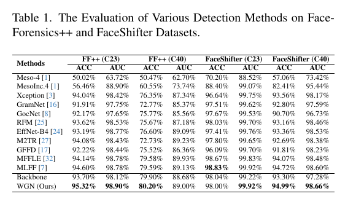
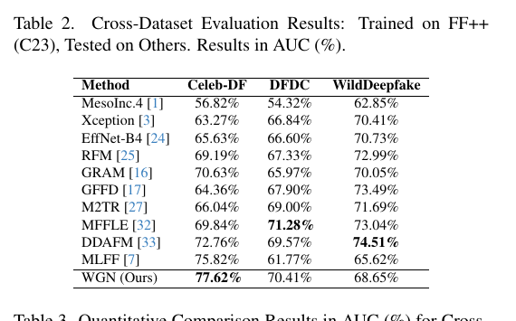
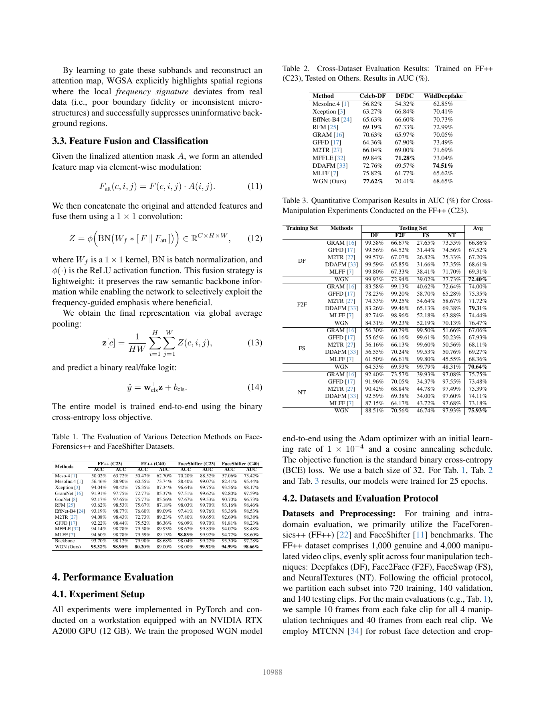

# WGN Official-Data Reproduction: Final Results

**Date:** 13 October 2026  
**Paper:** *WGN: Wavelet-Guided Network for Efficient and Generalised Deepfake Detection* (CVPRW 2026)  
**Status:** All planned main, cross-dataset, FaceShifter, and cross-manipulation experiments are complete.

## Reproduction scope and caveat

The authors' official WGN source code and pretrained checkpoint were not publicly available when this reproduction was started. The current implementation is therefore reconstructed from the paper, not claimed to be an exact execution of author-released code. The architecture preserves the reported core design: a pretrained MobileViT-S backbone, Haar-wavelet high-frequency guidance, gated feature fusion, and binary classification.

## Setup used

- GPU: NVIDIA GeForce RTX 5090, 32 GB VRAM
- Environment: local Conda environment on Windows; no administrator-level system changes
- Backbone: `mobilevit_s.cvnets_in1k`, pretrained weights
- Model size: 5,758,793 trainable parameters
- Input: MTCNN face crops resized to 256 x 256
- Official FaceForensics++ split: 720 train / 140 validation / 140 test videos
- Sampling: 40 frames per real video and 10 frames per fake video
- Training: 25 epochs, batch size 32, Adam, learning rate 1e-4, cosine schedule, FP32, seed 1024

## Data preparation completed

- Downloaded 12,000 official FaceForensics++ MP4 files: c23 and c40, each containing Original, Deepfakes, Face2Face, FaceSwap, NeuralTextures, and FaceShifter.
- Generated 180,000 face crops at 256 x 256.
- All 12 preprocessing jobs completed with zero failed jobs and zero center-crop fallbacks.
- MTCNN missed the face on 18 of 180,000 sampled frames (0.01%); those frames reused the nearest valid face box from the same video.
- The final manifest was validated for group, compression, split, video count, frame count, file existence, and sampled image integrity.

## Completed main results

Paper values and our values below are frame-level test metrics.

<table>
  <tr>
    <th width="58%">Original paper - Table 1</th>
    <th width="42%">Our completed reproduction</th>
  </tr>
  <tr>
    <td></td>
    <td valign="top">
      <b>FF++ c23 test</b> 
      ACC: 94.12% (paper: 95.32%) 
      AUC: 98.44% (paper: 98.90%)  
      <b>FF++ c40 test</b> 
      ACC: 78.80% (paper: 80.20%) 
      AUC: 87.09% (paper: 89.00%)  
      <b>FaceShifter c23</b> 
      ACC: 98.24% (paper: 98.00%) 
      AUC: 98.88% (paper: 99.92%)  
      <b>FaceShifter c40</b> 
      ACC: 93.87% (paper: 94.99%) 
      AUC: 97.20% (paper: 98.66%)
    </td>
  </tr>
</table>

| Experiment | Metric | Paper | Ours | Difference |
|---|---:|---:|---:|---:|
| FF++ c23 | ACC | 95.32% | 94.12% | -1.20 pp |
| FF++ c23 | AUC | 98.90% | 98.44% | -0.46 pp |
| FF++ c40 | ACC | 80.20% | 78.80% | -1.40 pp |
| FF++ c40 | AUC | 89.00% | 87.09% | -1.91 pp |
| FaceShifter c23 | ACC | 98.00% | 98.24% | +0.24 pp |
| FaceShifter c23 | AUC | 99.92% | 98.88% | -1.04 pp |
| FaceShifter c40 | ACC | 94.99% | 93.87% | -1.12 pp |
| FaceShifter c40 | AUC | 98.66% | 97.20% | -1.46 pp |

Additional video-level results:

| Experiment | Video ACC | Video AUC |
|---|---:|---:|
| FF++ c23 | 97.00% | 99.51% |
| FF++ c40 | 89.86% | 93.52% |
| FaceShifter c23 | 97.50% | 99.66% |
| FaceShifter c40 | 93.21% | 99.29% |

The c23 run selected epoch 13 (zero-based checkpoint epoch 12) by validation accuracy and took approximately 41 minutes. The c40 run selected epoch 19 (zero-based checkpoint epoch 18) and took approximately 40 minutes.

## Completed cross-dataset evaluation

All evaluations use the best FF++ c23 checkpoint without target-dataset fine-tuning. Both frame- and video-aggregated AUC are reported because the exact aggregation used for the paper table is not fully specified.

<table>
  <tr>
    <th width="58%">Original paper - Table 2</th>
    <th width="42%">Our completed reproduction</th>
  </tr>
  <tr>
    <td></td>
    <td valign="top">
      <b>Celeb-DF (official v2 test split)</b> 
      Frame AUC: 65.03% 
      Video AUC: 69.70% 
      Paper: 77.62%  
      <b>DFDC</b> 
      Frame AUC: 69.54% 
      Video AUC: 71.00% 
      Paper: 70.41%  
      <b>WildDeepfake</b> 
      Frame AUC: 70.35% 
      Video AUC: 75.35% 
      Paper: 68.65%
    </td>
  </tr>
</table>

| Target dataset | Frames | Videos | Frame AUC | Video AUC | Paper AUC |
|---|---:|---:|---:|---:|---:|
| Celeb-DF (v2 used here) | 16,420 | 518 | 65.03% | 69.70% | 77.62% |
| DFDC | 132,116 | 4,704 | 69.54% | 71.00% | 70.41% |
| WildDeepfake | 165,662 | 806 | 70.35% | 75.35% | 68.65% |

**Celeb-DF version note.** Table 2 abbreviates the dataset as `Celeb-DF` and
does not print a version number. Its citation [13] is the CVPR 2020
*Celeb-DF: A Large-scale Challenging Dataset for DeepFake Forensics* release.
The dataset authors' official repository identifies that CVPR 2020 release as
Celeb-DF v2 and provides an official 518-video test list. Our evaluation used
exactly those 518 test videos. Therefore using v2 is well supported rather than
an apparent v1/v2 substitution, but the missing version label in the WGN paper
is retained here as a reporting ambiguity. See the
[official Celeb-DF repository](https://github.com/yuezunli/celeb-deepfakeforensics).

## FaceShifter results

Final test metrics from the best validation-accuracy checkpoints are:

| Compression | Best epoch | Frame ACC | Frame AUC | Video ACC | Video AUC |
|---|---:|---:|---:|---:|---:|
| c23 | 12 | 98.24% | 98.88% | 97.50% | 99.66% |
| c40 | 16 | 93.87% | 97.20% | 93.21% | 99.29% |

## Cross-manipulation: paper Table 3 versus reproduction

Models were independently trained for 25 epochs on one FF++ c23 manipulation
and evaluated on all four test sets. Values are frame-level AUC (%). The `Avg`
columns follow the paper exactly: the mean includes the in-domain diagonal.

### Original Table 3 image

The image below is the direct PDF page capture, not a recreated table. Table 3
is in the upper-right portion; click the image to inspect it at full resolution.

### Numeric side-by-side comparison

<table>
  <tr>
    <th rowspan="2">Training set</th>
    <th colspan="5">Original paper — Table 3</th>
    <th colspan="5">Our reproduction</th>
  </tr>
  <tr>
    <th>DF</th><th>F2F</th><th>FS</th><th>NT</th><th>Avg</th>
    <th>DF</th><th>F2F</th><th>FS</th><th>NT</th><th>Avg</th>
  </tr>
  <tr>
    <td>Deepfakes</td>
    <td>99.93</td><td>72.94</td><td>39.02</td><td>77.73</td><td><b>72.40</b></td>
    <td>99.83</td><td>73.49</td><td>43.35</td><td>72.76</td><td><b>72.36</b></td>
  </tr>
  <tr>
    <td>Face2Face</td>
    <td>84.31</td><td>99.23</td><td>52.19</td><td>70.13</td><td><b>76.47</b></td>
    <td>77.40</td><td>99.04</td><td>56.29</td><td>66.41</td><td><b>74.79</b></td>
  </tr>
  <tr>
    <td>FaceSwap</td>
    <td>64.53</td><td>69.93</td><td>99.79</td><td>48.31</td><td><b>70.64</b></td>
    <td>55.76</td><td>69.99</td><td>99.80</td><td>49.68</td><td><b>68.80</b></td>
  </tr>
  <tr>
    <td>NeuralTextures</td>
    <td>88.51</td><td>70.56</td><td>46.74</td><td>97.93</td><td><b>75.93</b></td>
    <td>80.62</td><td>64.97</td><td>42.11</td><td>97.66</td><td><b>71.34</b></td>
  </tr>
</table>

| Training set | Paper Avg | Reproduced Avg | Difference |
|---|---:|---:|---:|
| Deepfakes | 72.40% | 72.36% | -0.04 pp |
| Face2Face | 76.47% | 74.79% | -1.68 pp |
| FaceSwap | 70.64% | 68.80% | -1.84 pp |
| NeuralTextures | 75.93% | 71.34% | -4.59 pp |
| **All 16 train/test cells** | **73.86%** | **71.82%** | **-2.04 pp** |

For completeness, if only genuinely unseen off-diagonal cells are averaged,
the paper obtains 65.41% and this reproduction obtains 62.74% (-2.67 pp).
This is a derived diagnostic and is not the `Avg` definition printed in Table 3.

### Evidence

- [Original CVPRW paper](https://openaccess.thecvf.com/content/CVPR2026W/PPMisDet/papers/Ghosh_WGN_Wavelet-Guided_Network_for_Efficient_and_Generalised_Deepfake_Detection_CVPRW_2026_paper.pdf), Table 3 on PDF page 5
- [Direct page capture containing original Table 3](assets/wgn-paper-page-05.png)
- [Deepfakes result JSON](evidence/cross_manipulation/df/cross_manipulation.json) and [training summary](evidence/cross_manipulation/df/summary.json)
- [Face2Face result JSON](evidence/cross_manipulation/f2f/cross_manipulation.json) and [training summary](evidence/cross_manipulation/f2f/summary.json)
- [FaceSwap result JSON](evidence/cross_manipulation/fs/cross_manipulation.json) and [training summary](evidence/cross_manipulation/fs/summary.json)
- [NeuralTextures result JSON](evidence/cross_manipulation/nt/cross_manipulation.json) and [training summary](evidence/cross_manipulation/nt/summary.json)
- [Complete 100-epoch console record](evidence/cross_manipulation/training.stdout.log)
- [Machine-readable paper/reproduction comparison](evidence/cross_manipulation/comparison.json)
- [SHA-256 checksums](evidence/cross_manipulation/SHA256SUMS.txt)

All four runs contain 25 metric records, their summary and evaluation files are
present, and the runner ended with `ALL OFFICIAL CROSS-MANIPULATION EXPERIMENTS
COMPLETE` at 2026-10-13 16:51:34 (UTC+7). The stderr log was empty.

## Work implemented

- Official FaceForensics++ EU2 parallel downloader and integrity checks
- Official split acquisition and validation
- Resumable parallel MTCNN preprocessing for c23 and c40
- Sequential video decoding optimization to avoid expensive random seeks
- DeepfakeBench-style manifest generation with configurable compression
- WGN training and evaluation code for main, FaceShifter, cross-dataset, and cross-manipulation protocols
- Automatic validation and end-to-end experiment runner
- Separate JSON summaries and metric histories for each experiment

## Completion

All experiments in the stated reproduction scope are complete. Checkpoints and
datasets remain local because of their size and dataset licensing constraints;
the source code, configs, paper comparison, metric JSON files, full training
record, and checksums are committed for auditability.

