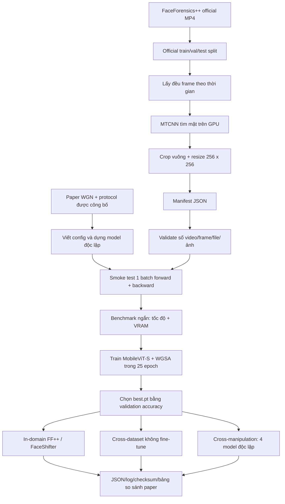

# Quy trình reproduce WGN từ dữ liệu thô đến kết quả cuối

> Tài liệu nội bộ dành cho người vận hành thí nghiệm. Mục tiêu là giải thích không chỉ **chạy lệnh nào**, mà còn **dữ liệu đi qua đâu, mỗi file chịu trách nhiệm gì, tại sao có bước đó, điều kiện nào mới được coi là hoàn tất**, và những phần nào là thông số từ paper hay giả định của bản reproduce.

## 1. Phạm vi và mức độ “reproduce”

Paper được reproduce là **WGN: Wavelet-Guided Network for Efficient and Generalised Deepfake Detection** (CVPRW 2026).

Bản triển khai này là một **faithful independent reproduction**:

- Kiến trúc, phương trình WGSA, backbone, dữ liệu, cách chia tập và protocol thí nghiệm được dựng lại từ paper.
- Dữ liệu FaceForensics++ lấy bằng downloader chính thức và dùng official split.
- Tất cả thí nghiệm chính, FaceShifter, cross-dataset và cross-manipulation đã chạy xong.
- Tác giả không công bố source code/checkpoint WGN tại thời điểm thực hiện, nên đây không phải việc chạy lại nguyên code của tác giả và không thể gọi là byte-identical reproduction.
- Những chi tiết paper không nói rõ được giữ thành giả định có thể audit, thay vì trình bày như thông số chắc chắn của tác giả.

Tài liệu này mô tả **baseline WGN đã dùng để tạo bảng kết quả chính thức trên GitHub**. Các thử nghiệm nghiên cứu sau đó như domain generalization hoặc `wavelet-consistency regularization` không thuộc baseline này và không được trộn vào kết quả reproduce.

Snapshot kết quả baseline được đối chiếu với code trên GitHub tại commit `eaea01e0375f954e478c471438d775029ff49ad3` trước khi viết tài liệu này.

## 2. Toàn bộ pipeline ở mức cao



Một lần chạy chỉ được coi là **hoàn tất khoa học** khi có đủ:

1. dữ liệu đã validate;
2. smoke test forward/backward thành công;
3. đủ số epoch trong `metrics.jsonl`;
4. có `best.pt` và `summary.json`;
5. có file đánh giá tương ứng;
6. kết quả được đối chiếu với paper và có evidence/checksum.

`Smoke test passed` không có nghĩa là reproduce xong. Nó chỉ có nghĩa pipeline kỹ thuật có khả năng bắt đầu train.

## 3. Cấu trúc thư mục và trách nhiệm từng file

### 3.1. Code chính

| File/thư mục | Trách nhiệm |
|---|---|
| `configs/*.yaml` | Khóa các tham số của từng experiment: dataset, compression, backbone, seed, epoch, batch size, learning rate và output directory. |
| `src/wgn/model.py` | Chứa `WaveletGuidedSpatialAttention` và model hoàn chỉnh `WaveletGuidedNetwork`. |
| `src/wgn/data.py` | Đọc manifest, tạo record frame, transform ảnh, label và ba dataset train/val/test. |
| `train.py` | Seed, DataLoader, loss, optimizer, scheduler, vòng lặp train/validation, chọn checkpoint và test cuối. |
| `smoke_test.py` | Chạy đúng một batch qua forward, loss và backward để bắt lỗi trước khi train dài. |
| `benchmark.py` | Đo một số training step thật để ước lượng thời gian mỗi epoch và peak VRAM. |
| `evaluate_cross_dataset.py` | Dùng checkpoint FF++ c23 đánh giá dataset khác mà không fine-tune. |
| `evaluate_cross_manipulation.py` | Dùng một model train trên một manipulation và đánh giá trên cả DF/F2F/FS/NT. |

### 3.2. Tải và xử lý FaceForensics++

| File | Trách nhiệm |
|---|---|
| `faceforensics_download_v4.py` | Downloader chính thức của FaceForensics++; dùng server `EU2` theo email của authors. |
| `download_ffpp_official.ps1` | Cách tải tuần tự, dễ theo dõi và ít kết nối đồng thời. |
| `download_ffpp_official_parallel.py` | Chia 12 tác vụ tải độc lập và chạy tối đa 8 tác vụ đồng thời. |
| `splits/train.json`, `val.json`, `test.json` | Official identity/video pairs dùng để chống leakage giữa các split. |
| `preprocess_ffpp_official.py` | Lấy frame, MTCNN, xử lý box lỗi, crop, resize, ghi PNG và partial manifest. |
| `preprocess_ffpp_official_parallel.py` | Chạy 12 tác vụ preprocessing với 4 worker, sau đó merge manifest và kiểm tra count. |
| `validate_ffpp_official.py` | Kiểm tra cấu trúc manifest, count, file tồn tại và integrity/kích thước ảnh. |

### 3.3. Điều phối và kết quả

| File/thư mục | Trách nhiệm |
|---|---|
| `run_official_reproduction.ps1` | Chạy chuỗi thí nghiệm chính theo đúng thứ tự phụ thuộc. |
| `resume_official_cross_manipulation.ps1` | Bỏ qua experiment cross-manipulation đã đủ summary/evaluation và chạy experiment còn thiếu. |
| `runs/<experiment>/resolved_config.yaml` | Config thực tế đã dùng, giúp phát hiện khác biệt so với config dự định. |
| `runs/<experiment>/metrics.jsonl` | Một JSON record cho mỗi epoch, gồm train và validation metrics. |
| `runs/<experiment>/best.pt` | Model tốt nhất theo frame-level validation accuracy. |
| `runs/<experiment>/summary.json` | Best epoch, best validation metrics và test metrics cuối. |
| `runs/<experiment>/cross_*.json` | Kết quả cross-dataset hoặc cross-manipulation. |
| `CURRENT-REPRODUCTION-STATUS.md` | Trạng thái có thẩm quyền của checkpoint reproduce hiện tại. |
| `RTX5090-HISTORICAL-REPRODUCTION.md` | Kết quả lịch sử từ máy cũ; checkpoint không được lưu và không phải reference hiện tại. |
| `evidence/` trên GitHub | JSON, training log, ảnh bảng gốc từ paper và checksum phục vụ audit. |

Dataset, crop PNG và checkpoint không đẩy lên GitHub vì dung lượng và điều khoản dataset. Code, config, metric nhỏ và bằng chứng đối chiếu được commit.

## 4. Môi trường không cần quyền administrator

Máy reproduce dùng:

- Windows;
- NVIDIA RTX 5090 32 GB;
- Python 3.10;
- PyTorch 2.7.1 + CUDA 12.8;
- môi trường Python nằm trong workspace, không sửa Python hệ thống;
- cache Hugging Face/Torch và bytecode cũng chuyển vào `C:\sp1`.

Các package được khóa trong `requirements.txt`:

```text
torch==2.7.1
torchvision==0.22.1
timm==1.0.15
facenet-pytorch==2.6.0
numpy==1.26.0
scikit-learn==1.3.0
PyYAML==6.0.1
Pillow==12.3.0
opencv-python-headless==4.5.4.60
tqdm==4.66.1
```

Các runner đặt biến môi trường:

```powershell
$env:HF_HOME = 'C:\sp1\.cache\huggingface'
$env:TORCH_HOME = 'C:\sp1\.cache\torch'
$env:PYTHONPYCACHEPREFIX = 'C:\sp1\WGN\.pycache'
$env:HF_HUB_OFFLINE = '1'
$env:PYTHONUNBUFFERED = '1'
```

Ý nghĩa:

- Không cần quyền admin để ghi vào thư mục hệ thống.
- Pretrained weight được cache một lần; lúc train chính có thể chạy offline để tránh thay đổi hoặc lỗi mạng.
- `PYTHONUNBUFFERED=1` làm log xuất hiện ngay, hữu ích khi theo dõi tiến trình.

## 5. Nguồn và bố cục dữ liệu FaceForensics++

Downloader chính thức tạo sáu nhóm cho mỗi compression:

| Tên trong manifest | Nguồn official | Vai trò |
|---|---|---|
| `FF-real` | `original_sequences/youtube` | Video thật. |
| `FF-DF` | `manipulated_sequences/Deepfakes` | Deepfakes. |
| `FF-F2F` | `manipulated_sequences/Face2Face` | Face2Face. |
| `FF-FS` | `manipulated_sequences/FaceSwap` | FaceSwap. |
| `FF-NT` | `manipulated_sequences/NeuralTextures` | NeuralTextures. |
| `FF-FSh` | `manipulated_sequences/FaceShifter` | Tập FaceShifter bổ sung. |

Hai mức nén được tải:

- `c23`: nén nhẹ hơn, chất lượng cao hơn;
- `c40`: nén mạnh hơn, artifact nén lớn hơn và bài toán khó hơn.

Mỗi group/compression phải có đúng 1.000 MP4. Tổng cộng:

```text
6 groups x 2 compressions x 1,000 videos = 12,000 MP4
```

### Vì sao downloader song song có 12 task?

Mỗi cặp `(compression, group)` có URL/file độc lập. Wrapper tạo 12 subprocess và tối đa 8 worker để giảm thời gian chờ mạng. Mỗi task ghi log riêng, ví dụ:

```text
runs/ffpp_official_download_logs/c23_Deepfakes.log
runs/ffpp_official_download_logs/c23_FaceShifter.log
```

Tách log giúp biết chính xác group nào lỗi, thay vì phải tải lại tất cả. Song song chỉ tăng tốc phần I/O mạng; nó không làm một file đơn lẻ tải nhanh hơn giới hạn server. Nếu server không ổn định, dùng script tuần tự là phương án an toàn hơn.

## 6. Official split và chống data leakage

FaceForensics++ cung cấp các pair trong ba file split. `load_splits()` ánh xạ:

- video thật `first` và `second` vào cùng split;
- video fake hai hướng `first_second` và `second_first` vào cùng split.

Sau khi đọc cả ba file, code bắt buộc có:

```text
real names = 1,000
fake directional names = 1,000
```

Mỗi group/compression sau đó phải có:

| Split | Video/group |
|---|---:|
| Train | 720 |
| Validation | 140 |
| Test | 140 |

Điểm quan trọng không chỉ là tỷ lệ 72/14/14. Các video có liên hệ trong một pair phải ở cùng split; nếu random split từng file độc lập, thông tin cùng identity/source có thể rò từ train sang test và làm kết quả cao giả tạo.

## 7. Preprocessing: từ MP4 thành face crop

### 7.1. Lấy frame đều theo thời gian

Paper dùng 40 frame/video thật và 10 frame/video giả. Code dùng:

```python
np.linspace(0, frame_count - 1, count)
```

rồi làm tròn chỉ số, nghĩa là frame phủ từ đầu tới cuối video thay vì lấy liên tiếp một đoạn ngắn.

OpenCV decode tuần tự bằng `grab()` và chỉ `retrieve()` tại frame cần dùng. Cách này tránh liên tục seek ngẫu nhiên trong video nén, vốn là nguyên nhân preprocessing rất chậm ở phiên bản thử ban đầu.

### 7.2. Tại sao real lấy 40 nhưng mỗi fake chỉ lấy 10?

Trong main FF++ có bốn manipulation:

```text
1 real group x 40 frames = 40 real frames/video-id
4 fake groups x 10 frames = 40 fake frames/video-id
```

Vì vậy tập main cân bằng theo số frame giữa hai lớp mà không cần sampler riêng.

Số sample của main experiment cho mỗi compression:

| Split | Real frames | Fake frames (4 methods) | Tổng |
|---|---:|---:|---:|
| Train | 720 x 40 = 28,800 | 4 x 720 x 10 = 28,800 | 57,600 |
| Validation | 5,600 | 5,600 | 11,200 |
| Test | 5,600 | 5,600 | 11,200 |

Với FaceShifter hoặc train một manipulation, tỷ lệ frame trở thành 4 real : 1 fake. Baseline không dùng weighted loss hay balanced sampler cho trường hợp này. Đây là hệ quả trực tiếp của sampling protocol và cũng là một chi tiết có thể ảnh hưởng chênh lệch với paper nếu authors xử lý balance khác mà không mô tả.

### 7.3. Letterbox trước khi detect

Mỗi frame có thể là landscape và có resolution khác nhau. Code:

1. giữ nguyên aspect ratio;
2. resize sao cho cạnh dài vừa detector canvas;
3. pad bằng giá trị xám 127;
4. chuyển BGR sang RGB;
5. chạy MTCNN theo batch.

Script đơn có default detector size 640, nhưng wrapper dùng trong reproduction **override thành 512**, batch detect 16 và FP32. Đây là thông số thực tế phải dùng khi muốn lặp lại run đã báo cáo.

### 7.4. MTCNN và ánh xạ box

MTCNN chạy trên CUDA với:

```text
margin=0
keep_all=True
select_largest=True
post_process=False
```

MTCNN trả box trên ảnh đã letterbox. Code trừ padding và chia scale để đưa box về tọa độ frame gốc. Candidate đầu tiên được dùng; với `select_largest=True`, mục tiêu là khuôn mặt chính/lớn nhất trong cảnh.

### 7.5. Khi MTCNN không thấy mặt

Hai tầng fallback được dùng:

1. Nếu một vài sampled frame của video bị miss, lấy box của sampled frame hợp lệ gần nhất trong chính video đó.
2. Nếu toàn bộ sampled frame của video đều miss, dùng center square crop.

Kết quả thực tế:

- 18/180.000 frame MTCNN miss, tương đương 0,01%;
- cả 18 frame dùng nearest valid box;
- 0 frame phải center fallback;
- 0 preprocessing job thất bại.

Không bỏ frame miss vì bỏ frame sẽ làm count giữa các video không nhất quán và có thể làm lệch protocol.

### 7.6. Crop và lưu ảnh

Box được đổi thành hình vuông quanh tâm, clip vào biên ảnh, crop rồi resize về `256 x 256`. File được lưu PNG compression level 3:

```text
FaceForensics++-official-processed/
  FF-real/c23/000/000000.png
  FF-DF/c23/000_003/000000.png
  ...
```

Không cộng thêm margin quanh box vì `margin=0` và `crop_face()` dùng đúng side lớn nhất của detected box. Nếu paper/authors dùng margin khác, đây là một nguồn sai khác tiềm năng.

### 7.7. Parallel preprocessing và cơ chế chạy lại

Wrapper chia thành 12 task như downloader nhưng dùng tối đa 4 subprocess. Mỗi subprocess có MTCNN riêng và xử lý một group/compression. Con số 4 là thỏa hiệp giữa:

- decode video bằng CPU/disk;
- batched face detection bằng GPU;
- VRAM của nhiều MTCNN process;
- contention khi nhiều process đọc/ghi cùng ổ.

Nếu toàn bộ PNG dự kiến của một video đã tồn tại, preprocessor không detect/crop lại video đó nhưng vẫn đưa đường dẫn vào manifest. Vì vậy có thể chạy lại sau khi bị ngắt mà không làm lại phần đã hoàn thành. Tuy nhiên cần kiểm tra log và validate cuối; “file tồn tại” không tự chứng minh nội dung file đúng.

### 7.8. Manifest là hợp đồng giữa preprocessing và training

Manifest cuối `C:\sp1\data\FaceForensics++-official.json` có dạng:

```json
{
  "FaceForensics++": {
    "FF-DF": {
      "train": {
        "c23": {
          "000_003": {
            "label": "FF-DF",
            "frames": [
              "FaceForensics++-official-processed\\FF-DF\\c23\\000_003\\000000.png"
            ]
          }
        }
      }
    }
  }
}
```

Đường dẫn được ghi tương đối với `data root`, giúp cả dataset nằm dưới một root và tránh hard-code absolute path cho từng frame.

### 7.9. Vì sao tổng là 180.000 crop?

Cho một compression:

```text
real: 1,000 x 40 = 40,000
5 fake groups: 5 x 1,000 x 10 = 50,000
total/compression = 90,000
```

Hai compression tạo `2 x 90,000 = 180,000` PNG.

## 8. Validation dữ liệu trước khi đụng tới model

`validate_ffpp_official.py` kiểm tra:

1. đủ sáu group;
2. đủ c23 và c40;
3. mỗi group có 720/140/140 video;
4. real có 40 frame/video, fake có 10;
5. tổng cộng đúng 180.000 path;
6. mọi path đều tồn tại;
7. khoảng 1.000 ảnh trải đều trong danh sách mở được và đúng 256 x 256.

Lệnh:

```powershell
python .\validate_ffpp_official.py
```

Điều kiện pass cuối:

```text
VALID ... frames=180000 sampled_images=... size=256x256
```

Validation này phát hiện lỗi tải/merge/path/count và ảnh hỏng trong sample. Nó không đảm bảo mọi crop đều căn mặt đẹp; muốn đánh giá chất lượng crop cần thêm visual audit ngẫu nhiên.

## 9. Data loader: từ manifest thành tensor

### 9.1. `FrameRecord`

Mỗi frame được chuẩn hóa thành record gồm:

- `path`: file PNG;
- `label`: 0 cho real, 1 cho fake;
- `video`: ID để aggregate video-level;
- `manipulation`: group để tránh trùng key và phục vụ đánh giá.

### 9.2. Chọn frame

`_even_sample()` có thể lấy lại một số lượng frame đều từ danh sách manifest. Với config official, manifest đã có đúng 40/10 và request cũng là 40/10, nên không bỏ thêm frame.

Cross-dataset dùng `frames_per_video=0`, nghĩa là dùng toàn bộ frame đã có trong manifest target.

### 9.3. Transform

Train:

```text
Resize(256, 256) -> RandomHorizontalFlip() -> ToTensor()
```

Validation/test:

```text
Resize(256, 256) -> ToTensor()
```

Horizontal flip là giả định vì paper không mô tả augmentation chi tiết. Baseline không dùng color jitter, blur, JPEG augmentation hay normalization bổ sung. `ToTensor()` đưa pixel từ `[0,255]` về float `[0,1]`.

### 9.4. DataLoader

Training loader:

- batch size 32;
- shuffle;
- 8 workers;
- pinned memory;
- persistent workers;
- prefetch factor 2;
- `drop_last=True`;
- generator và worker được seed.

Validation/test không shuffle và không drop batch cuối.

Pinned memory kết hợp `.cuda(non_blocking=True)` cho phép copy CPU-to-GPU hiệu quả hơn. Nhiều worker giúp decode PNG/transform không chặn GPU, nhưng tăng worker quá mức có thể làm nghẽn disk hoặc RAM.

## 10. Model: tensor đi qua WGN như thế nào

```mermaid
flowchart LR
    X[Ảnh B x 3 x 256 x 256] --> BB[MobileViT-S pretrained]
    BB --> F[Feature F: B x C x H x W]
    F --> MEAN[Channel mean]
    F --> MAX[Channel max]
    MEAN --> G[Guide map = 0.5 mean + 0.5 max]
    MAX --> G
    G --> DWT[Haar DWT stride 2]
    DWT --> S[LL, LH, HL, HH]
    S --> STAT[Spatial mean: 4 số/sample]
    STAT --> MLP[Linear 4-h-4 + sigmoid]
    MLP --> W[Gate từng subband]
    S --> W
    W --> IDWT[Transpose convolution / inverse Haar]
    IDWT --> A[Min-max spatial attention A]
    F --> MUL[F nhân A]
    A --> MUL
    F --> CAT[Concat F và F nhân A]
    MUL --> CAT
    CAT --> FUSE[1x1 Conv + BN + ReLU]
    FUSE --> GAP[Global average pooling]
    GAP --> FC[Linear -> 1 logit]
```



### 10.1. Backbone

`timm.create_model("mobilevit_s.cvnets_in1k", pretrained=True, num_classes=0, global_pool="")` tạo MobileViT-S đã pretrained ImageNet nhưng bỏ classifier và global pooling để giữ feature map không gian.

Điều này trả lời câu hỏi “có train CLIP/backbone từ đầu không?” trong project trước: ở WGN không có CLIP; backbone là MobileViT-S pretrained. Tuy nhiên backbone **không bị freeze**. Toàn bộ tham số backbone vẫn nhận gradient và được fine-tune, nên mỗi batch vẫn phải forward và backward qua backbone.

Với input 256, backbone có feature channel `C=640`; spatial map ở mức cuối là khoảng `8 x 8`. Code lấy `self.backbone.num_features` thay vì hard-code 640 để fusion khớp với backbone.

### 10.2. Tạo guide map từ feature

WGSA giảm feature nhiều channel thành một spatial guide:

```text
mean_map = mean(F theo channel)
max_map  = max(F theo channel)
guide    = 0.5 * (mean_map + max_map)
```

Mean biểu diễn đáp ứng tổng quát; max giữ tín hiệu mạnh nhất tại mỗi vị trí. Kết hợp hai thống kê cho spatial clue mà không cần một convolution lớn.

### 10.3. Haar wavelet decomposition

Bốn kernel 2 x 2 cố định là:

```text
LL = [[ 1,  1], [ 1,  1]] / 2
LH = [[ 1, -1], [ 1, -1]] / 2
HL = [[ 1,  1], [-1, -1]] / 2
HH = [[ 1, -1], [-1,  1]] / 2
```

Chúng được `register_buffer`, nghĩa là đi cùng model/checkpoint và đi lên GPU nhưng không được optimizer cập nhật. `conv2d(..., stride=2)` tạo bốn subband:

- LL: thành phần thấp tần/cấu trúc tổng quát;
- LH, HL, HH: biến đổi theo các hướng, nhấn mạnh edge và chi tiết cao tần.

Deepfake thường để lại artifact biên/texture khó thấy ở RGB nhưng hiện rõ hơn trong high-frequency response; đây là ý tưởng cốt lõi cần giữ khi reproduce WGN.

### 10.4. Gate học được

Mỗi subband được spatial mean thành bốn số. MLP:

```text
Linear(4 -> gate_hidden_dim) -> ReLU -> Linear(hidden -> 4) -> Sigmoid
```

tạo hệ số `[0,1]` cho từng subband. Baseline dùng `gate_hidden_dim=4`. Paper mô tả cơ chế nhưng không công bố rõ mọi kích thước hidden; giá trị 4 là giả định triển khai.

### 10.5. Reconstruct attention và fusion

Subband sau gate được đưa qua `conv_transpose2d` với cùng Haar kernels để trở lại spatial size ban đầu. Attention thô được min-max normalize riêng từng sample:

```text
A = (raw - spatial_min) / (spatial_max - spatial_min + 1e-6)
```

Sau đó:

```text
attended = F * A
fused = ReLU(BN(Conv1x1(concat(F, attended))))
```

Attention có một channel và được broadcast lên toàn bộ feature channels.

Cuối cùng global average pooling cho vector `B x C`, linear layer trả một logit/sample. `sigmoid(logit)` mới là xác suất fake.

Model baseline có 5.758.793 trainable parameters.

## 11. Loss, optimizer, scheduler và seed

Config chính:

| Thành phần | Giá trị |
|---|---|
| Epoch | 25 |
| Batch size | 32 |
| Optimizer | Adam |
| Learning rate | 1e-4 |
| Weight decay | 0 |
| Scheduler | CosineAnnealingLR |
| Loss | BCEWithLogitsLoss |
| Precision | FP32 |
| Seed | 1024 |

`BCEWithLogitsLoss` nhận trực tiếp logit, ổn định số học hơn cách gọi sigmoid rồi BCE riêng.

`CosineAnnealingLR` có `T_max=25`. Scheduler step sau validation mỗi epoch. Một chi tiết khi đọc log: trường `lr` được ghi **sau** `scheduler.step()`, nên nó là learning rate chuẩn bị dùng cho epoch kế tiếp, không phải chính xác LR vừa dùng cho epoch vừa kết thúc.

Seed được đặt cho Python, NumPy, Torch CPU, tất cả CUDA device, DataLoader generator và worker. Tuy vậy code không bật toàn bộ deterministic algorithms và preprocessing bật cuDNN benchmark; do đó seed giúp giảm biến thiên nhưng không cam kết bitwise identical giữa GPU/driver/PyTorch khác nhau.

YAML có `precision: fp32`, nhưng `train.py` không có nhánh AMP/autocast; run là FP32 vì mọi operation chạy mặc định FP32. Không nên chỉ sửa chuỗi YAML thành BF16 rồi cho rằng code đã dùng BF16.

## 12. Smoke test: kiểm tra kỹ thuật trước train dài

Lệnh baseline:

```powershell
python .\smoke_test.py --config .\configs\wgn_ffpp_c23_official.yaml --batch-size 4
```

Smoke test:

1. đọc config và manifest;
2. build đủ train/val/test dataset;
3. lấy batch đầu;
4. đưa ảnh và label lên CUDA;
5. forward qua MobileViT-S + WGSA;
6. tính BCE loss;
7. backward một lần;
8. in sample count, parameter count, tensor shape, loss và peak VRAM.

Nó bắt được các lỗi thường gặp:

- JSON key hoặc path sai;
- ảnh không mở được;
- shape không khớp tại WGSA/fusion;
- CUDA/PyTorch không tương thích;
- backward lỗi;
- OOM ngay ở batch nhỏ.

Mặc định smoke test tạo backbone với `pretrained=False` để không phụ thuộc download. Thêm `--pretrained` nếu muốn kiểm tra cả việc đọc pretrained cache. Smoke test không chạy optimizer step, không đánh giá convergence và loss của một batch không phải số liệu báo cáo.

Một integration smoke mạnh hơn có thể dùng:

```powershell
python .\train.py `
  --config .\configs\wgn_ffpp_c23_official.yaml `
  --epochs 1 `
  --max-train-steps 2 `
  --output-dir C:\sp1\WGN\runs\smoke_integration
```

Lệnh này kiểm tra thêm optimizer, scheduler, validation, checkpoint và summary. Không được dùng output của nó làm kết quả paper vì train chỉ hai step.

## 13. Benchmark: ước lượng thời gian và VRAM

```powershell
python .\benchmark.py `
  --config .\configs\wgn_ffpp_c23_official.yaml `
  --warmup 10 `
  --steps 100
```

Warmup loại trừ thời gian khởi tạo CUDA/kernel/cache. Phần đo chạy training step đầy đủ gồm data transfer, forward, loss, backward và Adam step. Output gồm:

- sample count;
- step/epoch;
- second/step;
- sample/second;
- projected minute/epoch;
- peak allocated/reserved VRAM.

Ước lượng chỉ đáng tin khi worker, batch size, storage và transform giống run thật. Benchmark 100 step vẫn có thể khác toàn epoch nếu disk cache thay đổi.

## 14. Training loop chi tiết

### 14.1. Mỗi batch train

```text
batch PNG -> CPU tensor -> pinned memory -> GPU
-> optimizer.zero_grad(set_to_none=True)
-> model(images) -> logits
-> BCEWithLogitsLoss(logits, labels)
-> loss.backward()
-> optimizer.step()
```

Train metrics được tính bằng sigmoid + threshold 0,5 cho accuracy và raw probability cho ROC AUC.

### 14.2. Mỗi epoch

Sau train:

1. model chuyển sang `eval()`;
2. validation chạy trong `torch.no_grad()`;
3. tính frame loss/accuracy/AUC;
4. group score theo key `manipulation/video`;
5. lấy trung bình probability các frame của video;
6. tính video accuracy/AUC;
7. scheduler step;
8. append một JSON line vào `metrics.jsonl`;
9. nếu frame validation accuracy cao hơn trước, ghi đè `best.pt`.

Checkpoint selection dùng **frame-level validation accuracy**, không dùng validation AUC, video AUC hay test score. Test chỉ chạy một lần sau khi 25 epoch kết thúc và reload best checkpoint, tránh chọn model dựa vào test.

Nếu hai epoch có accuracy bằng nhau, code giữ epoch xuất hiện trước vì điều kiện là `>` chứ không phải `>=`.

### 14.3. Nội dung checkpoint

`best.pt` chứa:

```text
epoch       zero-based epoch index
model       state_dict
config      config đã dùng
val         validation metrics tại thời điểm lưu
```

Nó không chứa optimizer/scheduler state. Vì vậy baseline có thể dùng để inference/evaluation nhưng không hỗ trợ resume chính xác giữa epoch. Script `resume_official_cross_manipulation.ps1` là resume ở cấp experiment: bỏ qua run hoàn tất và chạy lại nguyên run còn thiếu.

### 14.4. Output hoàn tất

Một experiment train thành công phải có:

```text
runs/<name>/
  resolved_config.yaml
  metrics.jsonl        # 25 dòng cho 25 epoch
  best.pt
  summary.json
```

`summary.json` gồm `best_epoch`, `best_val` và `test`. Epoch trong JSON đếm từ 0; ví dụ `best_epoch=12` là checkpoint sau epoch thứ 13 theo cách nói thông thường.

## 15. Ba protocol đánh giá

### 15.1. Main in-domain FF++

Train riêng:

- model c23 trên real + DF + F2F + FS + NT c23;
- model c40 trên real + DF + F2F + FS + NT c40.

Mỗi model được test đúng compression tương ứng. Báo cả frame và video metrics; bảng paper chính so với frame-level.

### 15.2. FaceShifter

Train riêng model với `FF-real + FF-FSh` cho c23 và c40. Không dùng model main bốn manipulation để thay thế. Điều này tạo hai checkpoint độc lập và phản ánh protocol riêng trong paper.

### 15.3. Cross-dataset

Chỉ dùng `best.pt` của main FF++ c23, không fine-tune trên target. Targets:

- Celeb-DF v2 official test: 518 videos, 16.420 frames;
- DFDC manifest: 4.704 videos, 132.116 frames;
- WildDeepfake: 806 videos, 165.662 frames.

Evaluator đọc toàn bộ frame đã có trong manifest (`frames_per_video=0`). Với mỗi frame:

```text
score = sigmoid(model(frame))
```

Video score:

```text
video_score = mean(all frame scores of that video)
```

Sau đó tính frame AUC/ACC và video AUC/ACC riêng. Target data phải là face crop đã chuẩn bị; evaluator không chạy MTCNN trực tiếp trên raw target videos.

Paper ghi `Celeb-DF` nhưng citation là bản CVPR 2020 mà repository dataset xác định là v2; reproduction dùng đúng official 518-video test list của v2. Đây là lựa chọn có bằng chứng nhưng version label trong WGN paper vẫn là một ambiguity cần nói rõ.

### 15.4. Cross-manipulation

Đây không phải một model main đem test bốn lần. Quy trình là:

```text
Train model A chỉ với real + Deepfakes
Train model B chỉ với real + Face2Face
Train model C chỉ với real + FaceSwap
Train model D chỉ với real + NeuralTextures
```

Mỗi model train đủ 25 epoch trên c23 rồi được đánh giá trên test set của cả bốn manipulation. Kết quả là ma trận 4 x 4:

- đường chéo: train/test cùng manipulation;
- ngoài đường chéo: generalization tới manipulation chưa thấy.

Code `evaluate_cross_manipulation.py` báo frame-level AUC. Cột `Avg` của paper bao gồm cả đường chéo, nên reproduction cũng dùng mean cả bốn cell trong mỗi row để so trực tiếp. Báo thêm off-diagonal mean chỉ là diagnostic, không thay định nghĩa bảng paper.

Mỗi test group chứa 5.600 real frame + 1.400 fake frame = 7.000 frame. Accuracy trong tình huống này dễ bị ảnh hưởng bởi imbalance; Table 3 dùng AUC nên phù hợp hơn.

## 16. Trình tự runner chính

`run_official_reproduction.ps1` chạy theo thứ tự:

1. train main FF++ c23;
2. dùng best c23 đánh giá Celeb-DF v2, DFDC, WildDeepfake;
3. train main FF++ c40;
4. train/evaluate FaceShifter c23;
5. train/evaluate FaceShifter c40;
6. lần lượt train model DF, F2F, FS, NT;
7. sau mỗi model cross-manipulation, đánh giá trên cả bốn groups;
8. in completion marker.

Lệnh:

```powershell
powershell -ExecutionPolicy Bypass -File .\run_official_reproduction.ps1
```

Runner dừng ngay khi subprocess trả exit code khác 0. Marker cuối bắt buộc là:

```text
ALL OFFICIAL REPRODUCTION EXPERIMENTS COMPLETE
```

Runner giả định dữ liệu, manifests, pretrained cache và environment đã sẵn sàng. Nó không tự tải dataset để tránh vô tình vi phạm terms hoặc train trên download chưa hoàn chỉnh.

## 17. Cách theo dõi tiến trình

### 17.1. Preprocessing

Mỗi 20 video, log có JSON dạng:

```json
{
  "videos": 400,
  "total": 1000,
  "videos_per_second": 0.8,
  "eta_minutes": 12.5,
  "mtcnn_missing_frames": 2,
  "center_fallback_frames": 0
}
```

Theo dõi live một log:

```powershell
Get-Content .\runs\ffpp_official_preprocess_logs\c23_FF_DF.log -Wait
```

### 17.2. Training

Mỗi epoch in đúng một JSON record. Có thể xem số epoch đã ghi:

```powershell
(Get-Content .\runs\wgn_ffpp_c23_official\metrics.jsonl).Count
```

Xem record gần nhất:

```powershell
Get-Content .\runs\wgn_ffpp_c23_official\metrics.jsonl -Tail 1
```

Hoàn tất đủ 25 epoch phải có 25 dòng và `summary.json`.

### 17.3. GPU

```powershell
nvidia-smi -l 2
```

Cần phân biệt:

- GPU utilization: phần trăm thời gian GPU đang có kernel chạy;
- VRAM usage: lượng bộ nhớ đang giữ tensor/model/cache;
- CPU/disk bottleneck: GPU có thể rảnh vì đang đợi DataLoader/PNG dù VRAM vẫn cao.

VRAM không phải “không dùng GPU”; VRAM chính là bộ nhớ GPU cần để chứa weight, activation, gradient và optimizer state.

## 18. Kết quả baseline và thời gian thực tế

Các kết quả chính đã hoàn tất:

| Experiment | Paper ACC/AUC | Reproduce ACC/AUC | Chênh lệch AUC |
|---|---:|---:|---:|
| FF++ c23 | 95,32 / 98,90 | 94,12 / 98,44 | -0,46 pp |
| FF++ c40 | 80,20 / 89,00 | 78,80 / 87,09 | -1,91 pp |
| FaceShifter c23 | 98,00 / 99,92 | 98,24 / 98,88 | -1,04 pp |
| FaceShifter c40 | 94,99 / 98,66 | 93,87 / 97,20 | -1,46 pp |

Main c23 mất khoảng 41 phút, chọn zero-based epoch 12. Main c40 mất khoảng 40 phút, chọn zero-based epoch 18. Thời gian này thuộc RTX 5090 và pipeline WGN; không áp dụng trực tiếp cho DFD-HR/CLIP trước đó.

Cross-dataset AUC:

| Target | Paper | Reproduce frame | Reproduce video |
|---|---:|---:|---:|
| Celeb-DF v2 | 77,62 | 65,03 | 69,70 |
| DFDC | 70,41 | 69,54 | 71,00 |
| WildDeepfake | 68,65 | 70,35 | 75,35 |

Cross-manipulation mean toàn bộ 16 cells: paper 73,86%, reproduce 71,82%, chênh -2,04 pp. Chi tiết từng cell và ảnh Table 3 gốc nằm trong báo cáo final.

## 19. Các quyết định chắc chắn và các giả định

### 19.1. Được paper/protocol hỗ trợ rõ

- MobileViT-S;
- WGSA dựa trên Haar wavelet;
- input 256 x 256;
- 40 real / 10 fake frame mỗi video;
- batch size 32;
- Adam, learning rate 1e-4;
- cosine schedule;
- 25 epoch;
- FF++ c23/c40, FaceShifter, cross-dataset và cross-manipulation.

### 19.2. Phải suy luận hoặc lựa chọn khi triển khai

- dùng `timm` variant `mobilevit_s.cvnets_in1k` và ImageNet pretrained weights;
- `gate_hidden_dim=4`;
- horizontal flip là augmentation duy nhất;
- không thêm normalization ngoài `ToTensor()`;
- MTCNN margin 0, detector input 512 trong run parallel;
- Adam weight decay 0;
- seed 1024;
- chọn best checkpoint bằng frame validation accuracy;
- target video score là mean frame probability;
- dùng toàn bộ target frames trong cross-dataset;
- không class weighting cho single-manipulation/FaceShifter;
- fallback box gần nhất khi MTCNN miss.

Đây là các ứng viên đầu tiên cần kiểm tra nếu một máy khác hoặc một bản implement khác chênh nhiều với paper.

## 20. Vì sao kết quả có thể không trùng tuyệt đối

Theo mức ưu tiên điều tra:

1. **Không có code/checkpoint tác giả:** cùng phương trình nhưng chi tiết tensor/fusion/gating có thể khác.
2. **Face preprocessing:** detector version, detector resolution, crop margin và fallback làm thay đổi pixel model nhìn thấy.
3. **Augmentation/normalization:** paper không cung cấp đầy đủ.
4. **Checkpoint selection:** accuracy so với AUC, frame so với video có thể chọn epoch khác.
5. **Class balancing:** đặc biệt FaceShifter và single-manipulation.
6. **Dataset manifest/aggregation:** số frame target và frame-to-video aggregation ảnh hưởng cross-dataset mạnh.
7. **Pretrained weight implementation:** variant MobileViT-S khác có thể không hoàn toàn tương đương.
8. **Randomness và software stack:** seed không bảo đảm deterministic tuyệt đối.

Celeb-DF v2 là chênh lớn nhất. Điều này không thể tự động kết luận model/code sai vì DFDC gần paper và WildDeepfake còn cao hơn. Pattern đó phù hợp với domain shift đặc thù: distribution mặt, compression, generation artifacts và preprocessing của Celeb-DF khác FF++. Muốn cải tiến cần tạo experiment mới và giữ baseline bất biến, không sửa baseline rồi ghi đè kết quả reproduce.

## 21. Quy trình chạy lại thủ công từ đầu

### Bước 1 — Kiểm tra environment

```powershell
python --version
python -c "import torch; print(torch.__version__, torch.version.cuda, torch.cuda.get_device_name(0))"
python -c "import timm, cv2, sklearn, facenet_pytorch; print('imports OK')"
```

### Bước 2 — Tải FaceForensics++ sau khi đã chấp nhận terms

```powershell
python .\download_ffpp_official_parallel.py
```

Kiểm tra đủ 12 task success và đủ 1.000 MP4/task.

### Bước 3 — Preprocess

```powershell
python .\preprocess_ffpp_official_parallel.py
```

Kiểm tra 12 partial manifests, 12 logs và final manifest.

### Bước 4 — Validate

```powershell
python .\validate_ffpp_official.py
```

Không chuyển bước nếu chưa có `VALID ... frames=180000`.

### Bước 5 — Smoke test

```powershell
python .\smoke_test.py --config .\configs\wgn_ffpp_c23_official.yaml --batch-size 4 --pretrained
```

Kiểm tra input/logit shape, loss hữu hạn, backward và VRAM.

### Bước 6 — Benchmark

```powershell
python .\benchmark.py --config .\configs\wgn_ffpp_c23_official.yaml
```

Ghi lại projected epoch time và peak VRAM trước khi cam kết chạy toàn bộ.

### Bước 7 — Chạy full protocol

```powershell
powershell -ExecutionPolicy Bypass -File .\run_official_reproduction.ps1
```

### Bước 8 — Audit output

Với mỗi training run:

- `resolved_config.yaml` đúng experiment;
- `metrics.jsonl` đủ 25 record;
- `best.pt` đọc được;
- `summary.json` có test metrics;
- cross evaluator có JSON riêng;
- log không có traceback/OOM/NaN.

### Bước 9 — So sánh paper

Không copy số từ terminal bằng tay nếu đã có JSON. Dùng JSON làm source of truth, quy đổi `[0,1]` sang `%`, báo chênh lệch theo percentage point và ghi rõ frame hay video level.

### Bước 10 — Lưu bằng chứng

Commit:

- code và config;
- resolved config;
- metrics/summary/evaluation JSON;
- console log cần thiết;
- ảnh bảng paper dùng đối chiếu;
- SHA-256 checksum.

Không commit dataset/checkpoint nếu license hoặc dung lượng không cho phép.

## 22. Checklist debug khi có lỗi

### Download chậm hoặc đứng

- Mở log đúng group/compression.
- Kiểm tra process còn network I/O.
- Xác nhận server là EU2.
- Không suy ra lỗi chỉ vì một log tạm thời không tăng; file lớn có thể chưa flush progress.
- Nếu parallel gây throttling, chuyển sang script tuần tự.

### Preprocessing chậm

- Kiểm tra GPU có process MTCNN.
- Kiểm tra disk throughput và CPU decode.
- Xác nhận wrapper đang dùng detector size 512, batch 16.
- Xem `videos_per_second`, không chỉ nhìn GPU utilization tức thời.
- Không tăng số worker vô hạn; mỗi process giữ model/VRAM và tranh I/O.

### GPU utilization thấp khi train

- Theo dõi step time cùng CPU/disk.
- Kiểm tra DataLoader workers/persistent workers/pinned memory.
- Kiểm tra PNG nằm trên local disk hay network drive.
- Chạy benchmark với `workers=0` và `workers=8` để xác định data bottleneck.
- Không đánh đồng utilization thấp với model không chạy GPU.

### Loss NaN hoặc AUC lỗi

- Kiểm tra label có cả real và fake trong split.
- Kiểm tra logits/loss ở smoke test.
- Kiểm tra crop hỏng/toàn màu.
- Không dùng AUC nếu subset chỉ có một class.

### Kết quả thấp bất thường

- So `resolved_config.yaml` với config official.
- Xác nhận checkpoint đúng c23/c40 và đúng experiment.
- Xác nhận backbone pretrained thực sự load ở lúc train.
- Xác nhận input nằm trong `[0,1]` và không normalize hai lần.
- Kiểm tra official split, frame count, label mapping 0 real/1 fake.
- Phân biệt frame metric và video metric.

## 23. Ranh giới giữa baseline reproduce và nghiên cứu cải tiến

Nguyên tắc để giữ kết quả có giá trị:

- Baseline đã hoàn tất phải giữ nguyên code/config/evidence.
- Mọi augmentation mới, domain shift method, WCR, loss mới hoặc sampling mới phải có tên run và config riêng.
- Không đánh giá cải tiến chỉ với một seed nếu muốn tuyên bố ổn định; nên chạy nhiều seed và báo mean ± standard deviation.
- Không tune trên test target. Hyperparameter phải chọn bằng source validation hoặc một protocol được tuyên bố trước.
- So sánh cải tiến với đúng baseline, cùng data split, preprocessing, epoch budget và metric.

Như vậy, phần reproduce trả lời “paper có lặp lại được gần mức báo cáo không?”, còn phần nghiên cứu trả lời “thay đổi mới có cải thiện generalization một cách đáng tin không?”. Hai câu hỏi liên quan nhưng không được nhập làm một.

## 24. Định nghĩa hoàn tất cuối cùng

WGN baseline trong project này được coi là hoàn tất vì:

- official data đã tải và validate;
- 180.000 crop đã tạo;
- main c23/c40 đã train đủ;
- FaceShifter c23/c40 đã train đủ;
- Celeb-DF v2, DFDC, WildDeepfake đã evaluate không fine-tune;
- bốn model cross-manipulation đã train 25 epoch và tạo đủ ma trận 4 x 4;
- kết quả đã so với Table 1/2/3 của paper;
- code, config, JSON, log và checksum đã commit;
- caveat “independent reproduction, không phải official author code” được công bố rõ.

Tài liệu kết quả để trích số cho reference hiện tại là `CURRENT-REPRODUCTION-STATUS.md`. `RTX5090-HISTORICAL-REPRODUCTION.md` chỉ dùng để tra cứu lần chạy cũ. Tài liệu hiện tại dùng để hiểu và vận hành pipeline; nếu hai tài liệu khác nhau về một con số, ưu tiên JSON evidence và checksum, sau đó sửa tài liệu mô tả thay vì sửa dữ liệu gốc.

